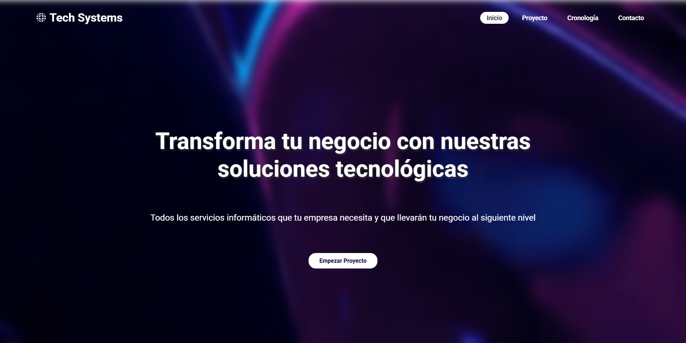

# Tech Systems · Web corporativa de una consultora tecnológica

Sitio web multipágina para **Tech Systems**, una consultora tecnológica ficticia con sede en Elche (España) orientada a pequeñas y medianas empresas. Está desarrollado únicamente con **HTML5 y CSS3**, sin frameworks ni JavaScript, como entrega de la Tarea UP6 de los módulos **LMSGI** (Lenguajes de Marcas y Sistemas de Gestión de Información) y **Proyecto Intermodular** del ciclo de Desarrollo de Aplicaciones Web.



## Contenido del sitio

| Página | Archivo | Qué contiene |
| --- | --- | --- |
| Inicio | `index.html` | Sección *Hero* con el mensaje principal y botón «Empezar Proyecto», y galería con las 4 tarjetas de servicios. |
| Proyecto | `proyecto-reservas.html` | Presentación del producto estrella, el **Sistema de Gestión de Reservas (SGR)**, y una barra lateral (`aside`) «Sobre nosotros». |
| Cronología | `cronologia.html` | Tabla con las fases del proyecto (identificación, planificación, ejecución, control y cierre), con fechas y estado. |
| Contacto | `contacto.html` | Página de contacto de la empresa. |

### Servicios que presenta la consultora

- **Desarrollo Web (Full Stack):** soluciones a medida, de la interfaz al servidor.
- **Cloud Computing y DevOps:** infraestructura en la nube, despliegues automatizados y optimización de costes.
- **Gestión y Optimización de BBDD:** bases de datos como servicio, con foco en rendimiento, escalabilidad y seguridad.
- **Ciberseguridad y Auditoría:** protección de datos, análisis de vulnerabilidades y políticas de seguridad.

## Diseño

El concepto visual se basa en el estilo **Modern Tech Design**. El resultado es una web de aspecto oscuro, buscado a propósito, con una paleta de **morados, azules eléctricos y blancos** y tendencias como el **glassmorphism**.

- **Tipografía:** texto en blanco y en negrita para que destaque sobre los fondos oscuros.
- **Fondo animado:** un fondo en movimiento y en bucle, sin cortes mientras se navega. Lleva un efecto *blur* para dar contraste y mejorar la legibilidad del texto.
- **Degradado de transición:** un degradado de transparente a morado entre el fondo animado y los elementos de primer plano.
- **Tarjetas de servicios:** degradado de tres colores claros con opacidad reducida para lograr el efecto cristal (*glass*).
- **Iconos:** de uso libre, todos con el mismo estilo 3D *glossy* para mantener la coherencia visual.
- **Logo y favicon:** el favicon conserva el color original; el logo del encabezado se convirtió a blanco con un editor de imágenes para que combine con el nombre de la empresa y el menú.
- **Tabla de cronología:** tonos azules y filas pares e impares alternadas (cebreado), como pedía el enunciado de la tarea.
- **Estructura:** cabecera con navegación, contenido principal y pie de página con enlaces (política de privacidad, redes sociales y aviso legal), común a todas las páginas.

## Tecnologías

- **HTML5** semántico (`header`, `nav`, `main`, `section`, `aside`, `footer`, `table`)
- **CSS3**: Flexbox, variables CSS (`:root`), degradados, transparencias, animaciones y efectos de desenfoque
- Diseño con identidad visual propia: logo, favicon e iconos

## Estructura del repositorio

```
proyecto-web-consultora/
├── index.html
├── proyecto-reservas.html
├── cronologia.html
├── contacto.html
├── css/
│   └── style.css
├── img/
│   └── (logo, favicon e iconos de la web)
├── docs/
│   └── Captura_pagina_inicio.png
└── README.md
```

## Cómo ejecutarlo

No necesita instalación ni dependencias.

1. Clona el repositorio o descárgalo con **Code → Download ZIP** y descomprímelo por completo.
2. Abre `index.html` en tu navegador.

```bash
git clone https://github.com/irisrodriguezz/proyecto-web-consultora.git
```

> Si descargas el ZIP, descomprime todo antes de abrir la web; si no, las imágenes y los estilos no cargarán.

## Autoría

Proyecto realizado por Iris Rodríguez Ujj · Ciclo de Desarrollo de Aplicaciones Web · IES Severo Ochoa (Elche).

GitHub: [@irisrodriguezz](https://github.com/irisrodriguezz)
